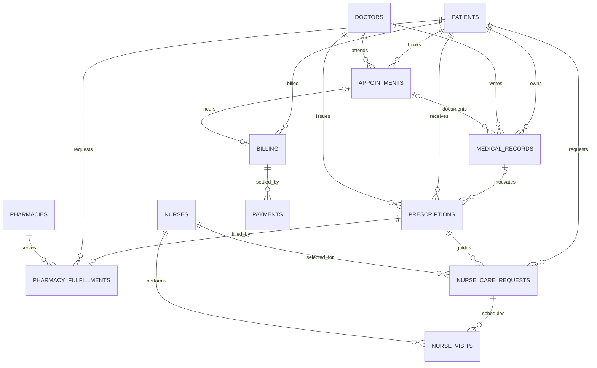

# Portfolio 1 — Database design and modelling

## Case study

MediCare is a simulated telemedicine platform for patients, doctors, nurses, and pharmacy staff. Patients find a doctor and book a video consultation, share symptoms, and receive a prescription. They can view nearby pharmacies that can fulfil the prescription or request a nurse for prescription-linked care and book visits during a planned treatment period. Billing staff can track consultation charges and payments. All records in this coursework system are fictional.

## Relational design

The implementation is in [`schema.sql`](schema.sql). `appointments` stores video consultation bookings, mode, meeting reference, and symptom summary. `medical_records` captures the doctor's consultation outcome; prescriptions link the doctor's order to the patient and record. `pharmacies` holds map coordinates, while `pharmacy_fulfillments` tracks where a prescription was sent. `nurse_care_requests` links the patient's selected nurse and prescription to the planned treatment window and visit frequency. `nurse_visits` stores individual sessions. Billing and payments cover consultation charges.

Primary keys are generated identity values. Foreign keys preserve relationships. Unique constraints prevent duplicate doctor appointment slots, doctor/nurse license numbers, email addresses, pickup/payment references, and nurse booking slots. Check constraints limit workflow states and reject invalid coordinates, dates, or non-positive amounts. The map query takes a transient origin and sorts pharmacies by approximate great-circle distance; route drawing/navigation belongs in the client map layer. It does not store a patient's precise live location.

## ER diagram

See [`er-diagram.mmd`](er-diagram.mmd). Cardinalities show one patient and one doctor per appointment, optional records/bills per appointment, multiple prescriptions per record, and multiple payments per bill.

## Normalisation

The design targets 3NF. Each table has a primary key; non-key fields describe that row's entity; and no non-key field is intended to depend on another non-key field. Patient contact details are stored once in `patients`, doctor details once in `doctors`, and payment events in `payments` rather than repeated bill columns. Nurse requests and individual visit appointments are separate because a multi-visit care plan can contain many bookings. This reduces update anomalies and supports multiple consultations, prescriptions, and installment payments. The report joins entities at read time. A production design would further review whether duplicated patient/doctor identifiers in `medical_records` and `prescriptions` should be derived exclusively through appointment/record relationships or retained as audited snapshots; this demo keeps them for direct ownership/history lookup.

## Individual verification notes

Before submission, capture your own pgAdmin schema/constraint evidence and explain one foreign key, one check constraint, why pharmacy orders reference prescriptions, and why a care request is separate from its scheduled nurse visits. Replace or qualify any design assumption that does not match your lecturer's expectations.

