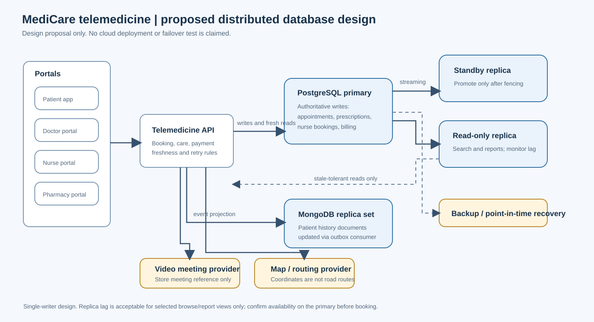

# Portfolio 5 - Distributed and cloud database exercise

## Scenario and scope

MediCare is a telemedicine platform: patients find doctors, book video consultations, receive prescriptions, locate nearby pharmacies, and arrange nurse visits. The distributed design below is a proposal for serving more than one region. It is not a deployed cloud system; no cloud database or failover was provisioned or tested. The diagram and trade-off analysis are design evidence, not operational test results. All examples in the coursework use fictional records.

## Proposed topology

The application uses PostgreSQL as the authoritative store for appointment bookings, prescriptions, nurse schedules, billing, and payments. MongoDB stores patient-centered history documents used by the history view. In a production service, changes that need to appear in both stores should be published through a transactional outbox and consumed idempotently; the application should not assume that two independent database writes commit atomically.

PostgreSQL streams changes to a standby that can be promoted after primary failure and to a read-only replica used for search and reporting. MongoDB uses a replica set for availability of the history-document store. The video and map providers remain external services; the database keeps a meeting reference and pharmacy coordinates, not video or map tiles.

## Read and write policy

| Operation | Proposed route | Reason and stale-read handling |
| --- | --- | --- |
| Create or change an appointment, prescription, nurse booking, bill, or payment | PostgreSQL primary | These are correctness-sensitive writes. Confirm availability and show the committed result from the primary. |
| Read a patient's just-booked appointment or payment status | PostgreSQL primary | Read-after-write consistency matters to the person who made the change. |
| Browse doctor profiles, pharmacy locations, or aggregate reports | PostgreSQL read replica; MongoDB history replica where suitable | These reads can tolerate brief replication lag. Show an update time or use the primary if a freshness threshold is exceeded. |
| Confirm a pharmacy can fulfill a prescription or confirm a nurse slot | Authoritative service/primary immediately before commitment | A stale search result is only a candidate; final availability must be checked against the authoritative data. |

Do not send booking or payment writes to a read replica. Keep a single PostgreSQL writer in the initial design. Multi-primary writes would add conflict resolution and can create duplicate bookings or inconsistent financial state.

## Replication and availability trade-offs

- **Synchronous replication** waits for a configured standby to acknowledge a commit. It reduces the chance of losing acknowledged writes during failover to that standby, but adds latency and can block writes when the synchronous standby is unavailable. It does not protect against every regional or operator error by itself.
- **Asynchronous replication** lets the primary acknowledge sooner. Replicas can lag, and a promoted replica may not contain the newest acknowledged changes. It is suitable for browse/search/report workloads only when the product can tolerate that staleness; monitor lag and route freshness-sensitive reads to the primary.
- **Failover** needs a health decision, fencing of the old primary, promotion, application reconnection, and post-recovery reconciliation. Automatic promotion without fencing risks two writers. The recovery time and data-loss objectives must be selected with the service owner and then tested; this coursework assigns no numeric SLA.
- **Backups** and point-in-time recovery address accidental deletes, corruption, and operator mistakes that replication would copy to replicas. A restore drill is still required before calling recovery proven.

For MongoDB, a replica set improves node availability. The app should decide which history views may briefly show stale documents and should make updates idempotent. PostgreSQL remains authoritative for booking and payment outcomes.

## Partitioning and sharding decision

Do not shard the current two-record demonstration. First measure volume, hot queries, write rates, and retention needs. If consultation records grow substantially, PostgreSQL time partitioning by consultation date can help retention and maintenance. If one region serves most requests, region-based partitioning may help locality, but a patient's related records and global identifiers must still be handled consistently. Sharding by patient ID can colocate patient history reads, but it makes cross-patient reporting and some cross-shard transactions more complex. For MongoDB, select a shard key only after examining query distribution and write hotspots; a poor key can concentrate load on one shard.

## Failure analysis (design review, not a test report)

| Failure | Expected effect | Proposed response | Evidence status |
| --- | --- | --- | --- |
| PostgreSQL primary host loss | Writes pause; replica reads may continue if healthy | Fence old primary, promote standby, reconnect app, verify bookings and payments, then restore redundancy | Not exercised; failover runbook required |
| Read replica lag | Search can show older doctor, pharmacy, or aggregate information | Monitor lag; route freshness-sensitive reads to primary; recheck availability before booking | Not measured in a distributed setup |
| MongoDB member loss | History service may have reduced availability | Replica-set election; retry idempotent reads/writes and monitor majority health | No replica set deployed for this portfolio |
| Region/network partition | Cross-region connectivity and replica freshness degrade | Preserve a single writer; keep writes in the primary region until safe failover is confirmed | Not tested |
| Accidental deletion or corruption | Replication can copy the bad change | Restore to a point in time from backup and reconcile downstream history projections | No backup restore performed |

## Defense prompts

1. Why are payments and appointment writes kept on one primary? Their uniqueness and state transitions require an authoritative decision; stale replicas cannot safely approve a second booking or report a new payment as missing.
2. What does asynchronous replica lag mean? A read replica may not yet contain a recent committed write. It is appropriate for some browse/report views but not for the immediate result of a booking or payment.
3. Why not make every replica synchronous? Waiting for remote acknowledgements increases latency and reduces write availability during link or replica failure. Choose synchronous scope based on the recovery objective and measured network behavior.
4. Why not shard now? This sample is tiny, so there is no measured scale problem to justify the added routing, cross-shard query, and transaction complexity.
5. What would make this design operationally credible? Provisioned replicas, lag and health monitoring, a fenced failover exercise, point-in-time restore drill, access controls, audit logs, and measured RTO/RPO results.

## AI assistance and student review

AI assistance was used to help organize the topology and explain database trade-offs. The student should check each decision against the assessment brief, replace this paragraph with the course-required declaration, and be able to explain the limitations and evidence status in their own words. No AI-detection evasion or fabricated deployment claim is part of this portfolio.

