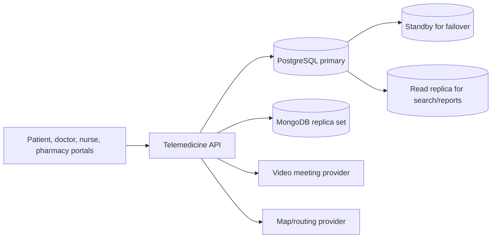

# Portfolio 5 — Distributed and cloud database exercise

## Proposed MediCare deployment

For a multi-region telemedicine service, keep an authoritative PostgreSQL primary in a selected cloud region and use synchronous or asynchronous streaming replicas according to the recovery-point objective. A standby in a second availability zone can be promoted during host failure. Read-only doctor and pharmacy search and aggregate reports can use replicas, while consultation booking, prescription fulfillment, nurse scheduling, and payment writes go to the primary. Monitor replication lag and define a tested failover process; asynchronous replication can lose the most recent transactions during abrupt primary loss.

For service-area scale-out, partition consultation and medical-history data by region and a time range, or shard by a stable patient identifier if patient-level access dominates. Keep a global patient/doctor identity strategy and route a patient's related records consistently. Cross-shard analytics require aggregation and may be eventually consistent. Avoid sharding prematurely: it adds operational complexity and cross-shard transactions.

MongoDB replica sets can provide redundant document storage; sharding can distribute very large collections. Choose shard keys only after measuring access patterns. Backups, point-in-time recovery, encryption, role-based access, audit logs, and tested restores are essential because the real scenario concerns sensitive health data. This coursework uses fictional data only.

## Scope and evidence

This is a design discussion, not a cloud deployment. No cloud service was provisioned. Explain the availability/consistency trade-offs in the diagram and state which operations can tolerate replica lag. Optionally demonstrate local PostgreSQL primary/standby only if the lecturer expects a live setup. Do not include credentials or real patient information.

